# Vacant

Find an empty classroom near you at Ohio State, free for as long as you need it.

### [Open Vacant](https://enesyilmazcode.github.io/Vacant/)

Choose **30 min**, **1 hour**, **2 hours**, or **rest of day**. Vacant suggests a
classroom you can walk to and shows a photo when one is available.

| | |
| :--: | :--: |
| 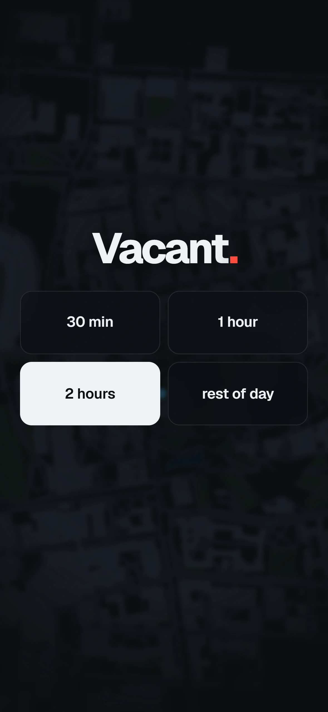 | 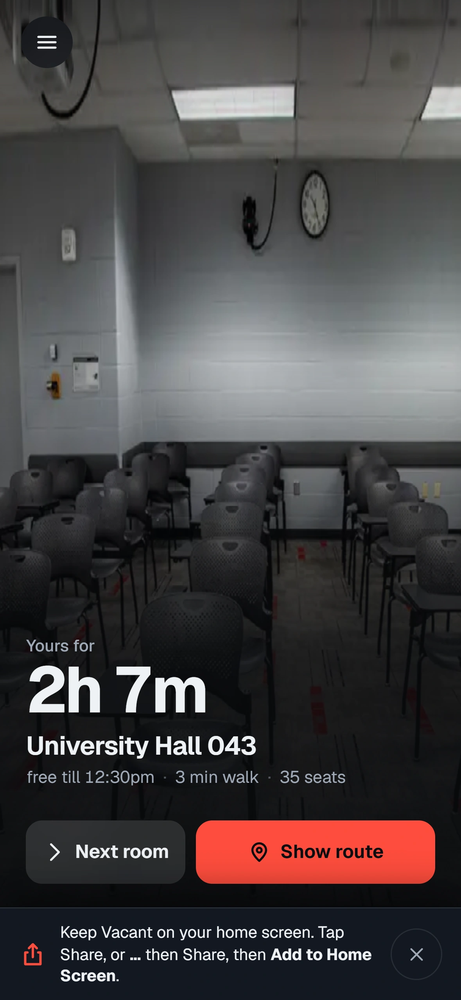 |
| Choose how long you need. | See how much time you get after the walk. |

## How much time you get

Vacant estimates the walk to a published building entrance using Ohio State's
sidewalk network at 78 metres per minute. It subtracts the walk and allows ten
minutes to pack up before the next class. In the example above, the next class
in University Hall 043 starts at 12:40pm. From 10:20am, a three-minute walk and a
12:30pm pack-up time leave **2h07** at the room. [Entrances](docs/research/entrances.md) · [Walking routes](docs/research/walking-routes-115.md)

## Next room or show route

Swipe left for the next room or right to see the route. The **Next room** and
**Show route** buttons and the left and right arrow keys do the same things.
Swipe down to return to the duration choices.

| | |
| :--: | :--: |
| 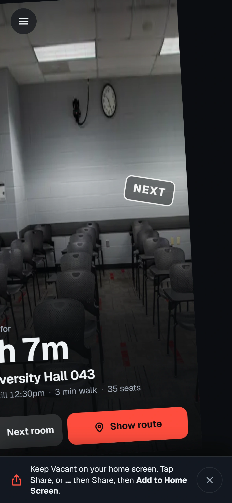 | 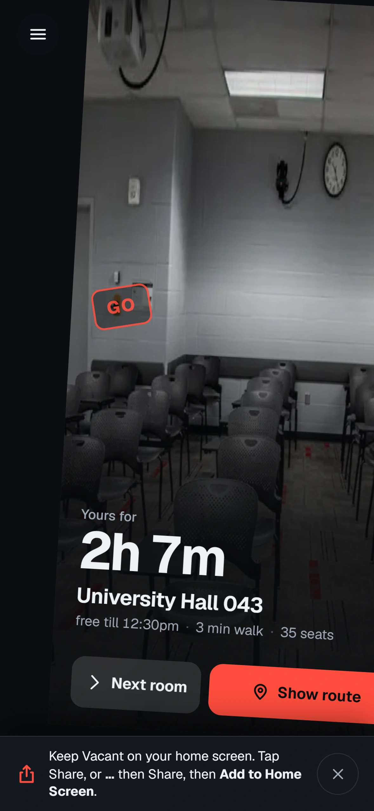 |
| Swipe left for another room. | Swipe right to see the route. |

Open the top-left menu to see all rooms, browse buildings, set your starting
location, check again, or read what Vacant knows. If location access is off,
Vacant starts from the Oval and offers a building picker.

| | |
| :--: | :--: |
| 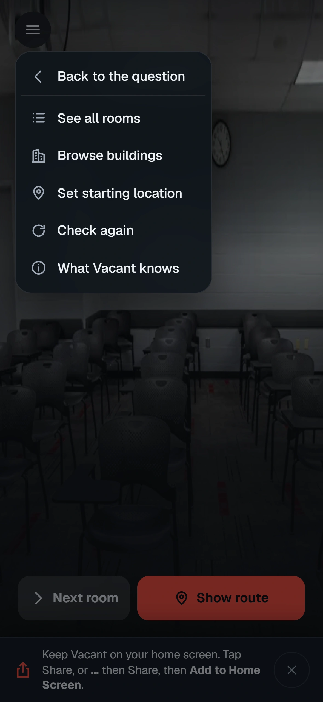 | 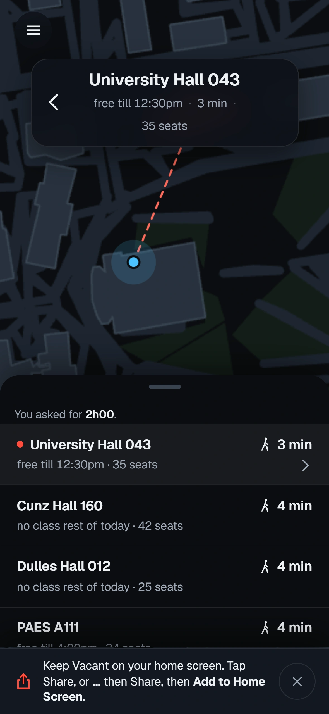 |
| Menu. | Route to the selected room. |

## See all rooms

Open **See all rooms** from the menu or from the end of the deck. Tap a row to
highlight the building and show the route. Tap the selected row again to open
the room's daily calendar.

| | | |
| :--: | :--: | :--: |
| 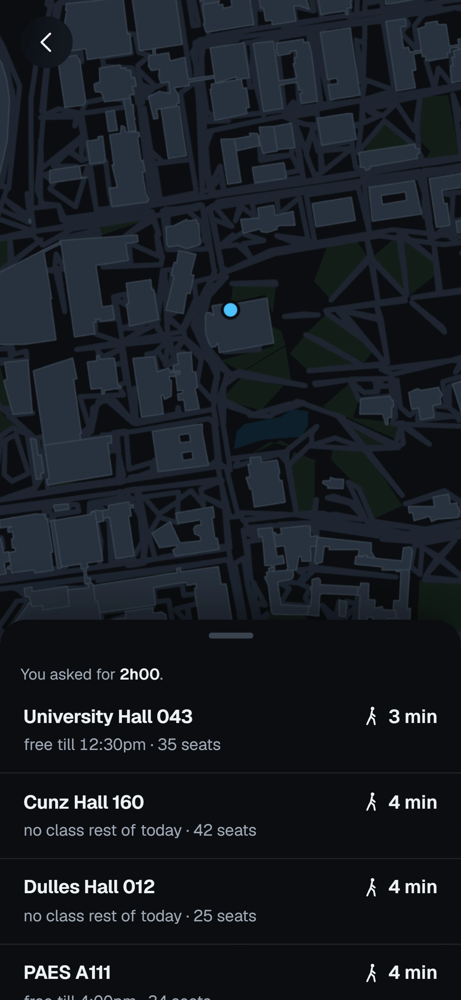 | 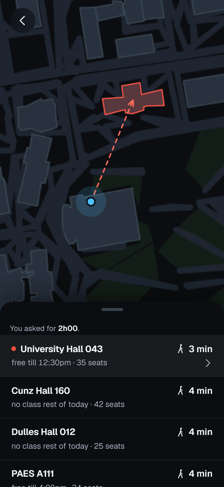 | 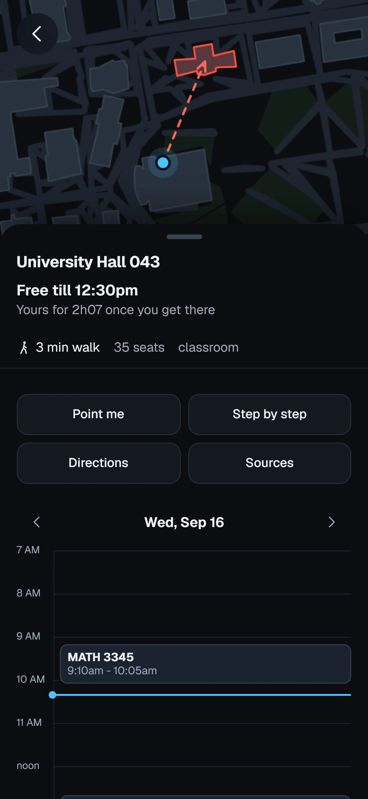 |
| Scan the list. | Select a room. | See its day. |

## Libraries and the Ohio Union

During finals week, the class schedule cannot establish classroom availability.
On days the university closes, such as Veterans Day or Thanksgiving, classroom
buildings are locked. On both, **Show libraries open now** opens the buildings
screen with libraries and the Ohio Union first. The buildings screen also leads
with study spaces when all classroom buildings are closed.

When a search returns no rooms, Vacant can suggest nearby study spaces with at
least 30 minutes left after the walk. Published hours tell you when the building
is open. Seat availability is unknown.

| | |
| :--: | :--: |
| 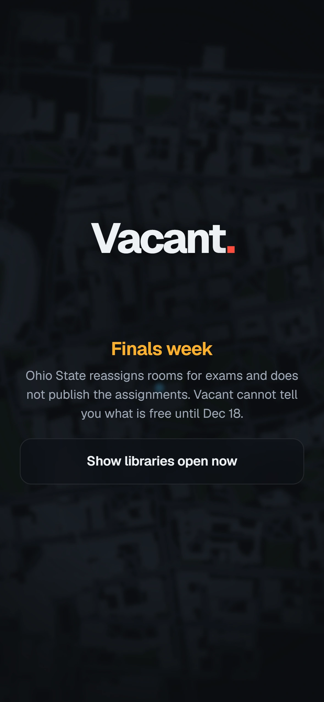 | 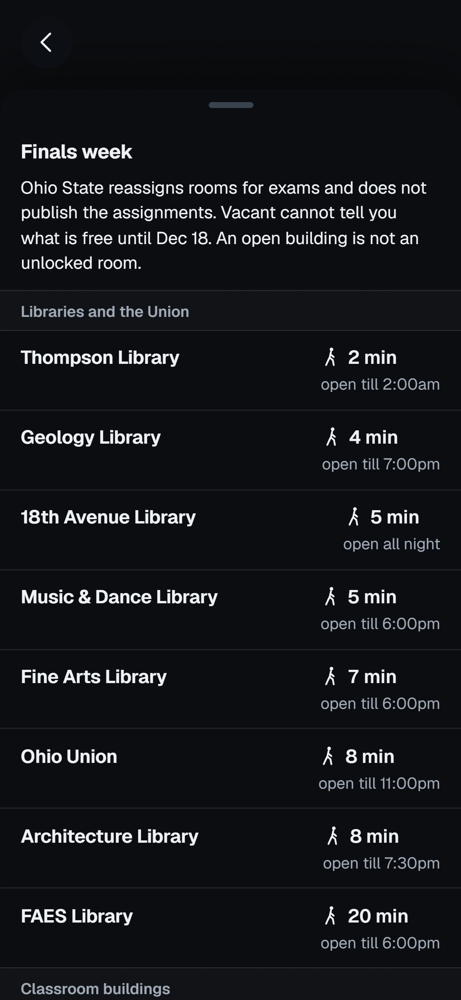 |
| Finals-week shortcut. | Published study-space hours. |

## What Vacant can verify

- **Building hours.** Vacant uses the Registrar's opening hours and searches
  during the 7am–11pm campus window, including weekends. In the Autumn 2026
  index, **424 of the 425 rooms have no Saturday class**. A class-only search
  calls all 424 of them free on a Saturday. **367** of those sit in buildings
  listed as closed and **57** are in a building that is listed as open.
- **Published coverage.** The Registrar's table covers 47 buildings, the index touches 46,
  and 0 of the 425 rooms sit in a building whose hours are unpublished.
- **Room bookings.** The weekly Room Matrix refresh covers two Monday-to-Sunday
  weeks. Vacant includes registered non-class events. A Registrar `ROOM BLOCK`
  is a hold on a room, often for the evening, and student groups can book
  inside it through a system that is not public. Vacant does not offer a room
  during a hold and labels that time **may be booked**. It flags missing event
  coverage outside those two weeks. Unscheduled use and individual room locks
  are unknown. [Data sources and coverage](docs/DATA.md)

## Report a wrong answer

If Vacant sent you to a room that was locked, occupied or booked, open **What
Vacant knows** from the menu and press **This was wrong**. It opens a
pre-filled GitHub issue with the app's version and data dates, and you need a
GitHub account to submit it. Your location is included only if you tick the box.

## Install and use offline

On iPhone, open Vacant in Safari and tap **Share** (sometimes under **…**), then
**Add to Home Screen**. On Android, use **Install app** in Chrome's menu.

After a successful online load and cache warm-up, Vacant can rank rooms offline
from the saved schedule. The cached app uses 204 KB of shell and about 121 KB of schedule,
gzipped. Room photos are cached as you view them.

## Run locally

Use Node.js 22 or newer for tests and scripts. The app loads its files from
`/Vacant/`, the path it has on GitHub Pages, so serve the folder that *contains*
the `Vacant` checkout, not the checkout itself.

```sh
git clone https://github.com/EnesYilmazcode/Vacant.git
python3 -m http.server 8000
```

Open [localhost:8000/Vacant/](http://localhost:8000/Vacant/). Opening
`localhost:8000` from inside the checkout leaves the duration buttons disabled.
The [developer page](http://localhost:8000/Vacant/dev/) lets you pick a time and
starting point. Use `?dev1` on the main page for a teaching-day example from
Dreese Laboratories, or press **D** three times to open the developer panel. The
[photo crop preview](http://localhost:8000/Vacant/dev/warp.html) shows how
classroom photos fit a phone screen.

```sh
npm test
node scripts/shoot.mjs          # refresh screenshots with local Chrome or Chromium
node scripts/shoot.mjs --check  # run the same capture checks without writing files
```

The screenshots use the checked-in Autumn 2026 schedule with a fixed mobile
viewport and campus location. The capture script saves the rendered screen text
in `docs/media/frames.json` so tests can check the image descriptions.

## Maintain Vacant

Vacant runs as a static site on GitHub Pages. GitHub Actions refreshes the
active term's class index, two weeks of room bookings, and published study-space
hours. The browser ranks rooms from the committed data.

The app starts in `index.html` and `js/app.js`. Ranking lives in
`js/engine.js`, the campus map in `js/map.js`, and the published study-space
hours logic in `js/study.js`.

- [Data sources, refresh cadence, and rebuild commands](docs/DATA.md)
- [Deployment, rollback, and offline cache](docs/DEPLOY.md)
- [Scheduled jobs and term rollover](.github/OPS.md). A new term is staged with
  `node scripts/roll-term.mjs <term> --prepare` and switched on with `--flip`
  after the current term's finals.
- [Design decisions](docs/DECISIONS.md) and [research notes](docs/research/)
- [Backlog](docs/BACKLOG.md) and [ground-truth walk](docs/research/ground-truth-walk.md)

## Licence

The code is [MIT](LICENSE). Vacant is an independent student project. Data
comes from public Ohio State sources, with attribution in the repository.
Classroom photographs © The Ohio State University, OTDI Classroom Services.
[Data provenance](data/README.md) · [Privacy and affiliation](privacy.html)
